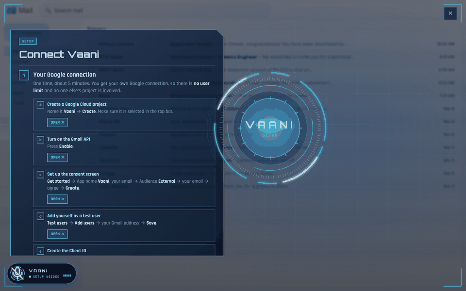
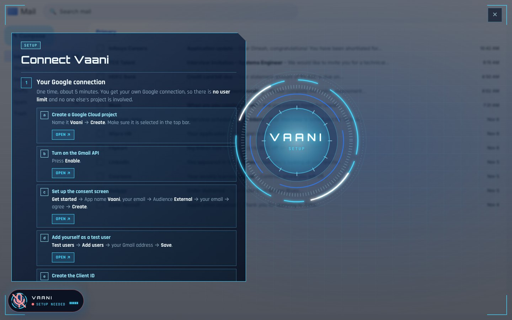
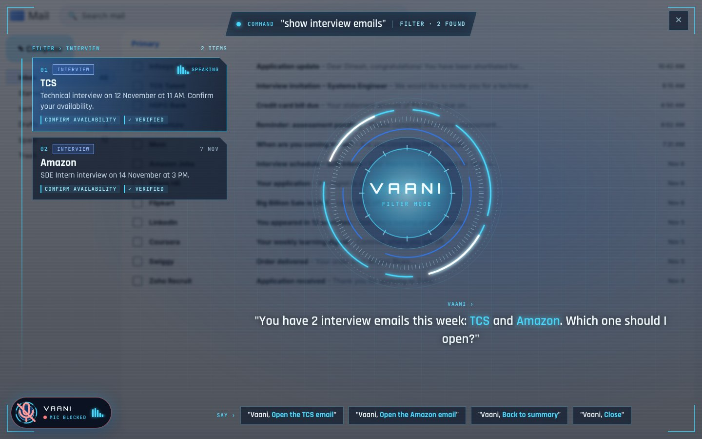
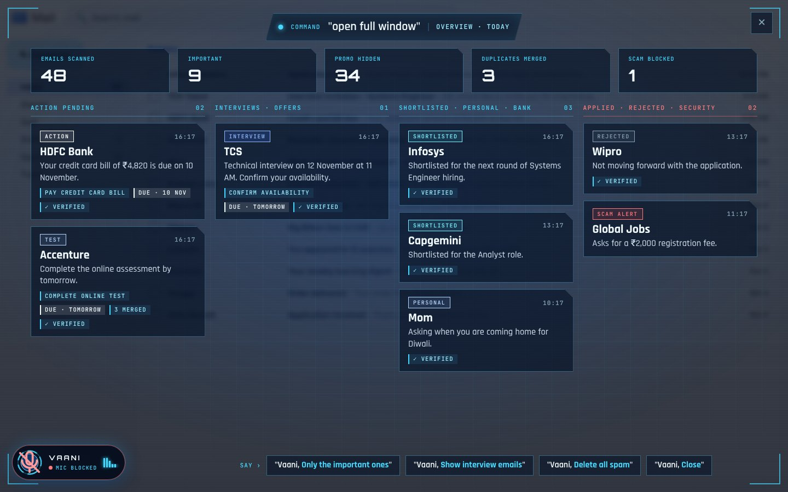
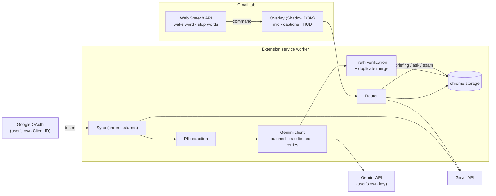

<div align="center">

# VAANI

### A voice-controlled AI agent that lives inside Gmail

Speak to your inbox in **English, Hindi or Hinglish**. Vaani reads, groups and verifies your emails, then briefs you in 30 seconds through a JARVIS-style overlay, with no server and no user limit.




</div>

---

## Why

A job seeker's inbox mixes shortlists, interview invites, bills, family messages, promotions and scams. Gmail shows them one by one. **Vaani turns 100 emails into one short spoken briefing**, tells apart *"application received"* from *"shortlisted"* (and proves it), and lets you act by voice. For example: *"Vaani, delete all spam."*

## Features

- 🎙 **Always-on voice** with the wake word *"Vaani"*, live captions, and *"stop"* to interrupt. The agent ignores its own voice.
- 🗣 **Multilingual commands** in English and Hinglish (*"spam ke saare message delete karo"*). It is robust to mis-hearing ("span" → spam).
- 🧠 **AI briefing** that groups similar emails and speaks one card at a time in priority order.
- ✅ **Truth verification:** every status the AI claims ("interview", "offer"…) must be backed by an exact quote from the email, or it is flagged *Check manually*.
- 🔁 **Duplicate intelligence:** 3 reminders from the same company become 1 card with the latest deadline.
- 🛡 **Scam detection:** fake job offers and phishing go to a red security section.
- 🔒 **PII redaction:** OTPs, Aadhaar, PAN, card, phone and UPI IDs are masked **before** any text reaches the AI.
- 📂 **Acts inside Gmail:** opens folders in the same tab, searches, and moves *all* spam to Trash in one confirmed step, with **Undo**.
- 🧩 **Zero backend:** each user brings their **own Google Client ID** (guided wizard) and **own free Gemini key**. That means no server costs, no shared quota and no 100-user cap.

## Screenshots

| Setup wizard (inside Gmail) | Spoken briefing, one card at a time |
|---|---|
|  |  |
| **"Show interview emails"** | **"TCS ka interview message dikhao"** |
|  |  |
| **"Open full window"** | **"Delete all spam"** → confirm → done |
|  |  |

## How it works



1. **Sync:** every minute the service worker pulls only *new* messages (Gmail History API), parses MIME without a DOM, and **redacts PII**.
2. **Understand:** emails go to Gemini in batches of 8 with a strict JSON schema (category, status, priority, deadline, action, evidence quote).
3. **Verify:** the evidence quote is matched against the original text. Unproven claims are downgraded and their confidence is capped.
4. **Brief:** emails are de-duplicated by matter, ranked, and spoken card by card, with the overlay highlighting each one.
5. **Act:** commands such as *open spam* change Gmail's URL in the same tab. *Delete all spam* trashes every spam message after one spoken "confirm", and keeps an undo log.

## Engineering highlights

| Area | What I built |
|---|---|
| **Voice UX** | Continuous recognition with auto-restart, a wake-word state machine, barge-in "stop", echo suppression of the agent's own TTS, and auto-pause in background tabs |
| **LLM reliability** | Schema-constrained output, zod validation, an evidence-quote check against the source (anti-hallucination), batching for free-tier quotas, and exponential back-off |
| **Privacy by design** | Regex-based PII masking before the LLM, no backend, tokens kept only in session storage, one-click sign-out and delete |
| **Security** | OAuth `state` CSRF check, granted-scope check, refusal of client secrets, a closed Shadow DOM, HTML-escaping of all email content, and a pre-commit **secret scanner** with an auto-installed git hook |
| **Architecture** | Pure, shared TypeScript core (classification, Q&A, verification, briefing) reused by both the extension and an optional Node server |
| **Testing** | 42 unit and integration tests (Vitest), plus a **browser E2E** that loads the real extension in Chromium against a fake Gmail page and mocked Google APIs |

## Tech stack

| Layer | Tech |
|---|---|
| Extension | TypeScript, Chrome Manifest V3, Shadow DOM, Web Speech API (STT + TTS), `chrome.identity`, `chrome.alarms`, `chrome.storage`, esbuild |
| AI | Google Gemini (`generateContent`, JSON schema output) |
| APIs | Gmail REST API, Google OAuth 2.0 |
| Shared core | TypeScript + zod (classification, verification, briefing, Q&A) |
| Optional server | Node.js, Express 5, JSON-file storage or MongoDB, React 19 + Vite + Tailwind dashboard |
| Quality | Vitest, Playwright (E2E), GitHub Actions CI, secret-scanning git hook |

## Getting started

### Use it
1. Download the release ZIP (or run `npm run release`) and extract it.
2. Open `chrome://extensions` → turn on **Developer mode** → **Load unpacked** → select the `vaani-extension` folder.
3. Open **Gmail**. The *Connect Vaani* wizard opens and walks you through:
   - creating your own Google Cloud project and **Client ID** (about 5 minutes, one time, with direct links and a copy button),
   - **Sign in with Google**,
   - pasting your free **Gemini API key** from [AI Studio](https://aistudio.google.com/apikey).
4. Say **"Vaani, give me today's summary."**

A full step-by-step guide in Hinglish is in [docs/GUIDE-HINGLISH.md](docs/GUIDE-HINGLISH.md).

### Voice commands

| Say | Result |
|---|---|
| "Vaani, give me today's summary" / "aaj ka summary batao" | Spoken briefing, one card at a time |
| "Vaani, show interview emails" | Filtered list |
| "Vaani, open the TCS email" / "TCS ka interview message dikhao" | Detail card with evidence |
| "Vaani, open it in Gmail" | Opens that thread in the same tab |
| "Vaani, open full window" | Full overview |
| "Vaani, open spam" / "spam kholo" | Gmail Spam folder in the same tab |
| "Vaani, delete all spam" → "confirm" | All spam to Trash in one go |
| "Vaani, undo" | Restores the last deletion |
| "Vaani, how many rejections this week?" | AI answer with source cards |
| "stop" · "close" · `Alt+V` (type a command) | Control |

## Privacy & security

- No Vaani server. Email data goes only to Google (Gmail) and, for analysis, to Gemini with **the user's own key**, after PII masking.
- Permission is `gmail.modify`: Vaani **cannot send** email and **cannot permanently delete**. Every change needs a confirmation and can be undone.
- Details are in [SECURITY.md](SECURITY.md).

## Development

```bash
npm install
npm test            # server + extension tests
npm run typecheck
npm run release     # → extension/release/vaani-extension (load unpacked)
```

```
extension/   Chrome extension (main product)
  src/gmail/   overlay UI, voice, command parser
  src/bg/      OAuth, Gmail API, sync, Gemini, storage, router
server/      shared AI core (src/ai/*Core.ts, src/intel, src/privacy) + optional Node server
web/         optional React dashboard
design/      editable HUD design file
docs/        screenshots, demo, guides
```

## Roadmap

- Smart reply drafts with spoken review and approval
- Deadline extraction to Google Calendar
- Attachment understanding (offer letters, PDFs)
- Application journey tracking (applied → interview → offer)
- Chrome Web Store release

## Author

**Dinesh Saini**. Built as a portfolio project on voice UX, LLM reliability and privacy-first design.

## License

[MIT](LICENSE)
