<div align="center">

# VAANI

### A voice assistant that lives inside your Gmail

Give it a name, talk to it in **English, Hindi or Hinglish**, and it takes care of your inbox. It reads your emails out to you, writes emails and replies **inside Gmail's own compose box**, adds events to your calendar and saves notes, all by voice.


</div>

---

## Contents

- [What is Vaani?](#what-is-vaani)
- [What's new](#whats-new)
- [Main features](#main-features)
- [Screenshots](#screenshots)
- [How to install](#how-to-install-about-10-minutes-one-time)
- [Things you can say](#things-you-can-say)
- [About the free Gemini key](#about-the-free-gemini-key)
- [Your privacy](#your-privacy)
- [If something doesn't work](#if-something-doesnt-work)
- [How it works](#how-it-works-simple-version)
- [Built with](#built-with)
- [For developers](#for-developers)

## What is Vaani?

Vaani is a **Chrome extension**. Once you install it, a voice assistant appears on top of Gmail. You talk, it listens, and it does the work. It never opens a new window: everything happens on your Gmail page.

For example, you can say:

- *"Vaani, what's new today?"* and it reads out a short summary of your emails.
- *"Open Gmail compose"*, then *"vacation ke upar likho, mujhe 10 din ki chutti chahiye"*, and a polite, formal leave email appears in Gmail's compose box.
- *"Reply to this saying I'll attend."* and the reply is written in Gmail's own reply box.
- *"Did anyone ask for my help today?"* and it shows you those emails.
- *"Delete all spam."* and it cleans your spam folder (and you can undo it).

It works for **everyone**: students, job seekers, office workers, business owners. It looks at what each email is *about* and what the sender *wants from you*.

### Why I built it

An inbox mixes everything: job updates, bills, family messages, offers, ads and scams. Gmail shows them one by one, and you have to read all of them. Vaani turns 100 emails into **one short spoken summary**, so you know in a minute what matters, and then lets you act on it just by talking.

## What's new

| Version | What changed |
|---|---|
| **2.4.0** | Writes **inside Gmail's own compose and reply boxes**. "Open the Gmail compose" now works however you say it. |
| 2.3.4 | Never acts on its own voice coming back through the speakers. |
| 2.3.3 | Hears you even when you speak slowly or pause in the middle of a sentence. |
| 2.3.2 | Live subtitles with a **CC** on/off button. |
| 2.3.1 | Setup choices are remembered after a reload. |

## Main features

### 🗣 Talk to it
- **You choose its name.** On first install it asks *"What would you like to call me?"*. You can call it Vaani, Nova, Zara, or anything you like. That name is how you wake it up. *"Hey Nova…"*, *"arre Nova…"* and *"please Nova…"* all work.
- **English, Hindi and Hinglish.** *"spam ke saare message delete karo"* works just like *"delete all spam"*.
- **Speak at your own pace.** You can pause in the middle of a sentence. Vaani waits until you have really finished before it acts.
- **"Stop" always works.** Say "stop", "ruko", "bas" or "chup" and it goes quiet right away. You can also just start talking over it.
- **It doesn't confuse itself with you.** Its own voice coming back from your speakers is recognised and ignored, so it never "obeys itself".
- **Works from another tab.** Say its name and Gmail comes back to the front. You can also press **Ctrl + Shift + Space**.
- **Friendly, not bossy.** Ask *"how are you?"* and it chats back like a friend.
- **Pick your own voice.** You choose the voice, the speed and the pitch.
- **Live subtitles (CC).** What Vaani says is shown on screen, word by word. Turn it on or off with the **CC** button, or just say *"subtitles off"*.

### ✍️ Writes in Gmail for you
- **Inside Gmail's own compose box.** Say *"open Gmail compose"*, then tell it what you want: *"vacation ke upar likho, mujhe 10 din ki chutti chahiye"*. The AI writes a proper, formal email straight into Gmail's box. If you already typed a subject, it stays.
- **Replies in Gmail's reply box.** Open an email and say *"reply to this saying I'll attend"*, or just *"reply to TCS"*.
- **New emails to anyone.** *"Write an email to Priya about the meeting."* opens Gmail's compose, adds Priya's address and writes the email.
- **Change it by voice.** *"Make it shorter"*, *"thoda formal karo"*, *"also mention I'll call tomorrow"*.
- **Your exact words.** *"Type: see you tomorrow"* types exactly what you say, without AI.
- **Safe sending.** *"Send it"* presses Gmail's Send button after 5 seconds. Say "stop" to cancel. It refuses to send while a blank like *[start date]* is still there.

### ✉️ Your inbox
- **Daily summary.** Similar emails are grouped and read out one card at a time, most important first.
- **Smart boxes.** Boxes like *Help requests, Questions, Bills, Job updates* are made from what is really in **your** inbox.
- **Find anything.** *"Show emails from 25 October"*, *"unread emails"*, *"emails with attachments"*.
- **Organise.** Archive, star, mark as read, delete and add labels, with an **Undo** button.
- **Every Gmail folder.** Inbox, Sent, Drafts, Spam, Promotions, Purchases, Settings and the rest of the left sidebar all open by voice.
- **Who's waiting for you.** *"What's pending?"* lists people you haven't replied to yet.
- **Alerts.** *"Tell me whenever someone asks for help"* gives you a notification each time it happens.

### 📅 Calendar and notes
- *"What's on my calendar tomorrow?"*
- *"Add this interview to my calendar."*
- *"Note: call the bank tomorrow."* Notes are saved in Google Tasks.

### 📊 Your email history (SQLite)
Vaani keeps a small database of your emails **on your own computer**. That makes these answers instant, and they work **without using any AI**:
- *"How many interviews did I get this month?"*
- *"Show my job tracker."* (applied → shortlisted → interview → offer)
- *"Show my stats."*, *"Weekly report."*, *"Upcoming deadlines."*
- *"Export my applications."* downloads a CSV file.

### 🛡 Safe and honest
- **It never sends on its own.** It sends only after you say "send", and gives you 5 seconds to say "stop".
- **It never deletes forever.** Deleted emails go to Trash, and you can undo.
- **It doesn't make things up.** When the AI says "this is an interview", it must show the exact words from the email that prove it. If it can't, the email is marked *Check manually*.
- **It never invents details.** If an email needs something you didn't say (like a date), it leaves a blank like *[your time]* for you to fill in.
- **Scam warning.** Fake job offers and phishing emails get a red warning, and Vaani won't reply to them.
- **Private data is hidden from the AI.** OTPs, card numbers, Aadhaar, PAN, phone numbers and UPI IDs are hidden **before** any text goes to the AI.

## Screenshots

| Naming the assistant + setup | Spoken summary, one card at a time |
|---|---|
|  | 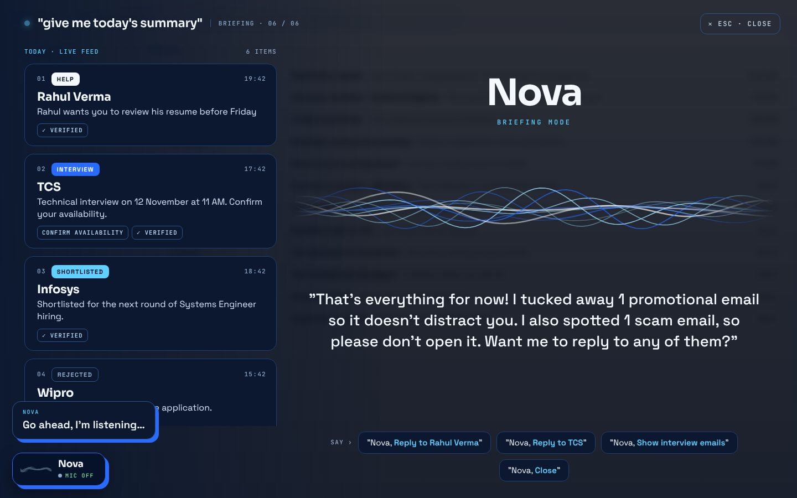 |
| **"Vacation ke upar likho…"** → written in Gmail's compose\* | **"Reply to this saying I'll attend"** → Gmail's reply box\* |
| 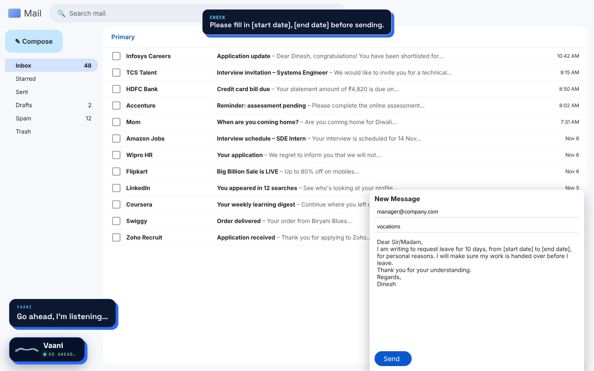 | 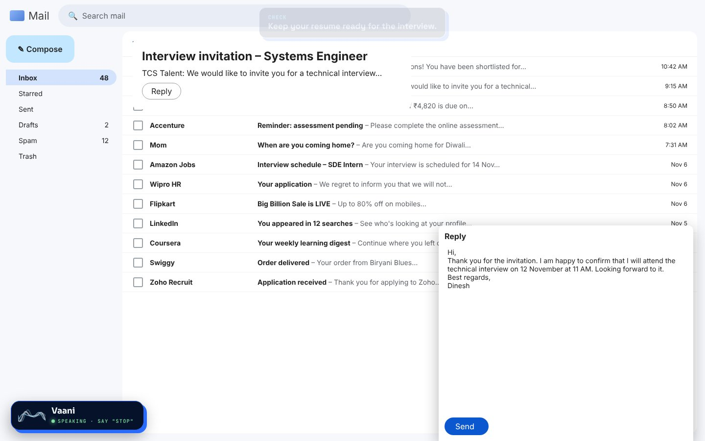 |
| **"Show the TCS interview email"** | **"Reply to this"** → 3 ideas |
| 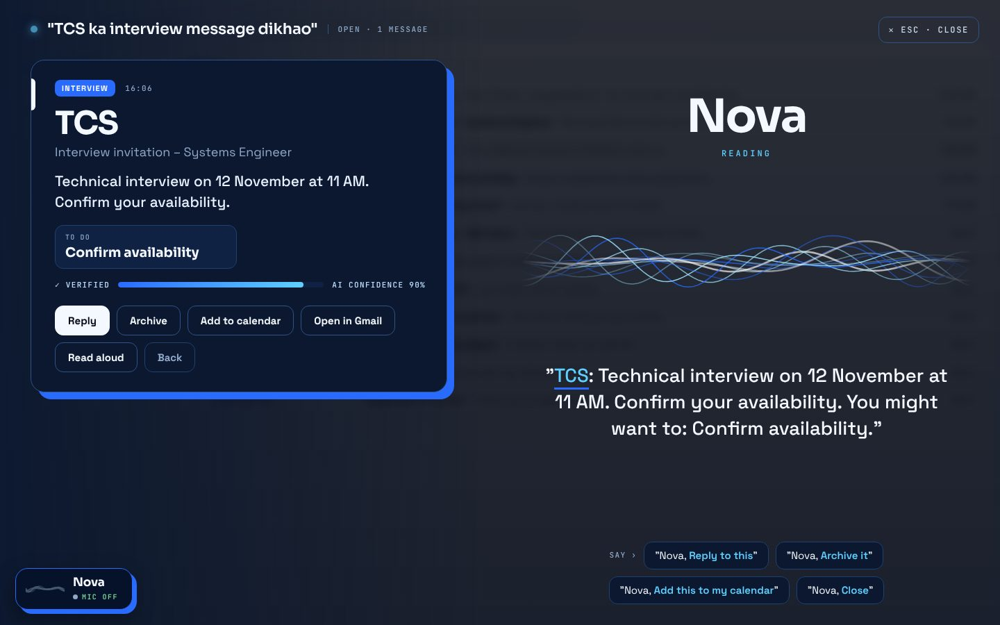 | 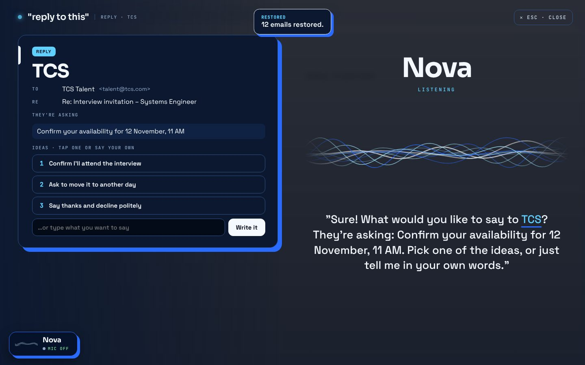 |
| **"What's on my calendar today?"** | **"Show my notes"** |
| 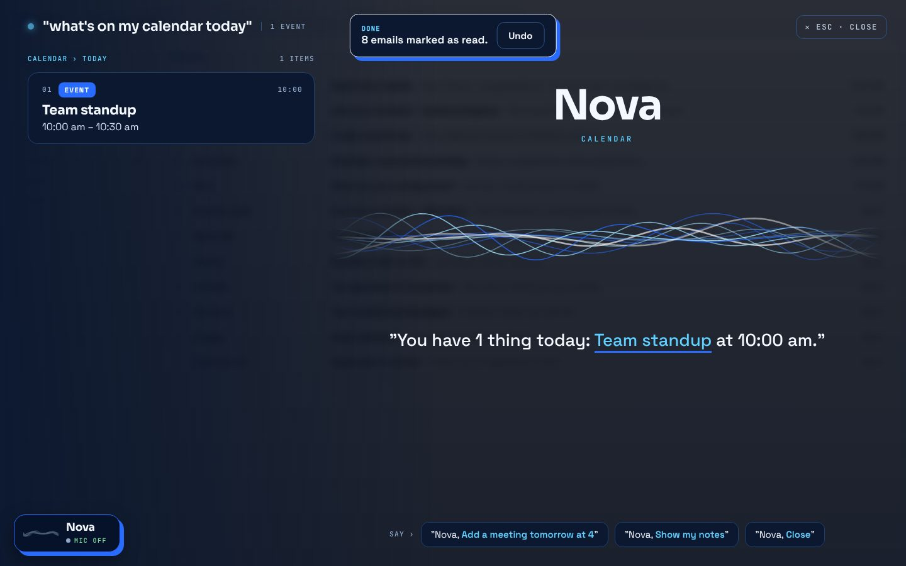 | 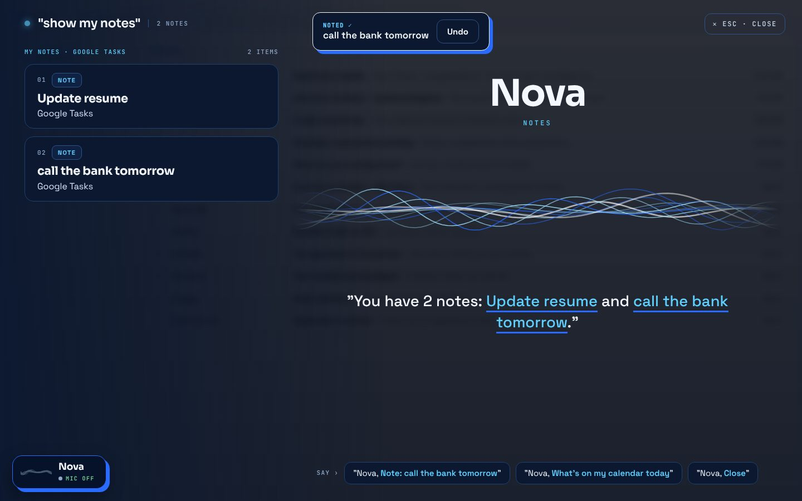 |
| **"Show emails from 25 October"** | **"Delete all spam"** → "yes" |
| 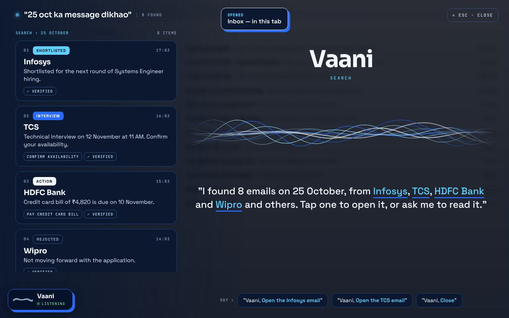 | 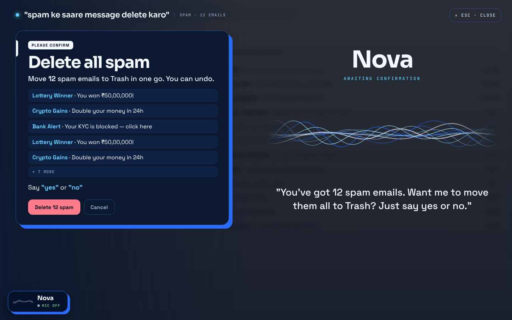 |
| **"Show my stats"** | **"Show my job tracker"** |
| 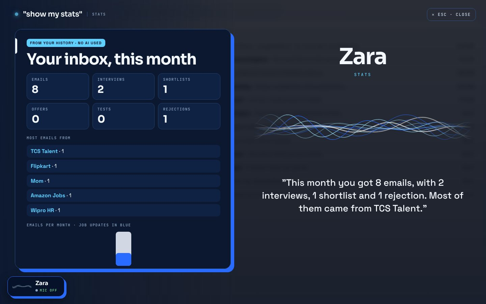 | 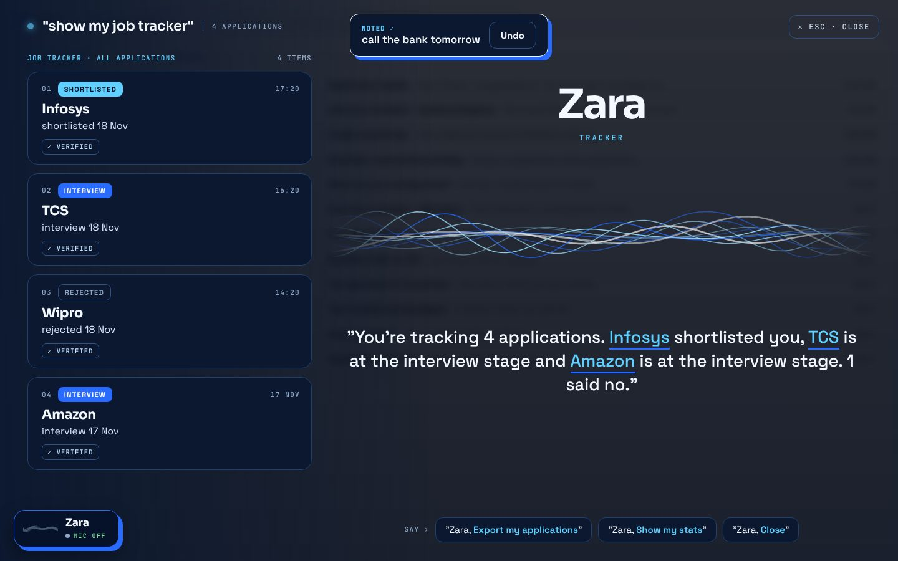 |
| **Boxes made from your inbox** | **"Did anyone ask for help today?"** |
| 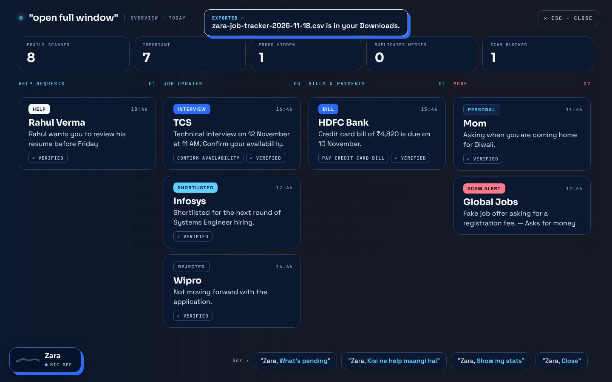 | 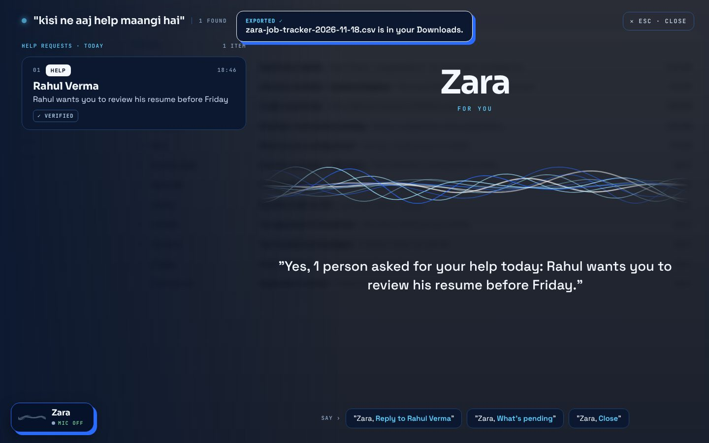 |
| **Weekly report** | **Job funnel** |
| 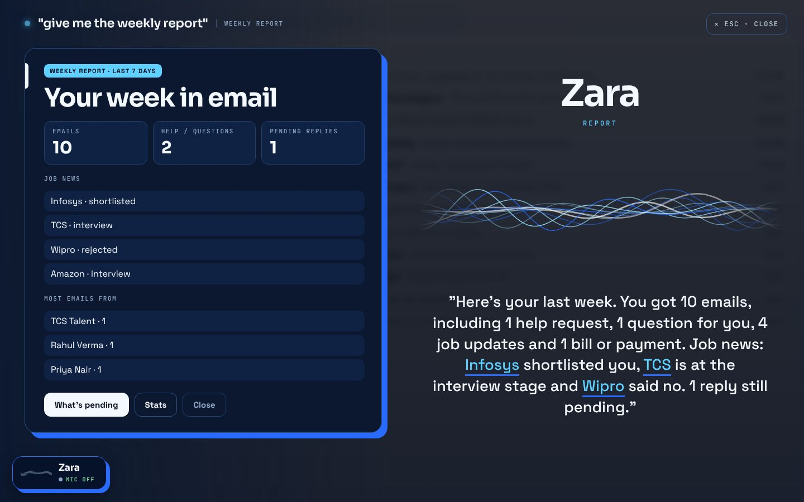 | 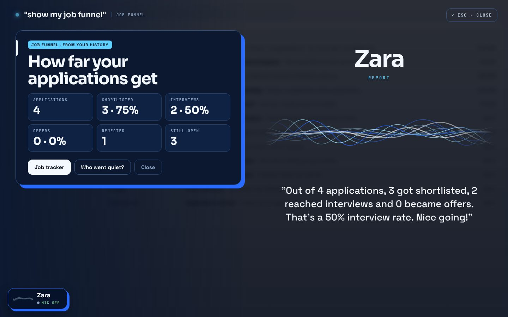 |

\* Taken on the test page that copies Gmail's compose and reply boxes.

## How to install (about 10 minutes, one time)

You need **Google Chrome** and a Google account.

1. Download `vaani-extension.zip` from the **Releases** page and unzip it.
2. Open `chrome://extensions` in Chrome.
3. Turn on **Developer mode** (top right).
4. Click **Load unpacked** and choose the unzipped **`vaani-extension`** folder (the one that has `manifest.json` inside).
5. Open **Gmail**. Vaani asks what you'd like to call it, and then walks you through 3 easy steps:
   - **Make your own Google Client ID.** The guide gives you direct links and a copy button. It takes about 5 minutes.
   - **Sign in with Google.**
   - **Paste your free Gemini API key** from [Google AI Studio](https://aistudio.google.com/apikey).
6. Say: **"Vaani, what's new today?"**

**Why do I need my own Client ID and key?** So that nobody shares a limit with anyone else. Everyone uses their own free Google quota, Vaani has no server, and there is no limit on how many people can use it.

**Updating to a new version:** unzip the new version and copy its files over your old `vaani-extension` folder (replace all). Then click the **↻ Reload** button on Vaani's card in `chrome://extensions` and refresh Gmail. Your name, voice, key and settings are kept. (If you *Remove* the extension instead, Chrome deletes its settings and you'll do the setup again.)

A step-by-step guide in Hinglish is here: [docs/GUIDE-HINGLISH.md](docs/GUIDE-HINGLISH.md).

## Things you can say

Start with the name you gave it (for example "Vaani, …"). Simple commands like "open inbox" work even without the name, and so does anything you say to an open Gmail compose box.

### Your inbox

| You say | What happens |
|---|---|
| "what's new today" · "aaj ka summary batao" | Reads out your summary |
| "show interview emails" · "show my bills" | Shows those emails |
| "open the TCS email" | Opens that email |
| "did anyone ask for my help?" · "any questions for me?" | Emails where people want something from you |
| "show emails from 25 October" · "unread emails" | Search |
| "archive it" · "star this" · "mark as read" · "delete this email" | Organise (with Undo) |
| "undo" | Takes back the last change |
| "delete all spam" → "yes" | Moves all spam to Trash |
| "open spam" · "promotions kholo" · "open settings" | Opens any Gmail folder |
| "create a label called Jobs" · "label this as Jobs" | Labels |

### Writing emails

| You say | What happens |
|---|---|
| "open Gmail compose" · "open the gmail compose" · "compose kholo" | Opens Gmail's own compose window |
| "vacation ke upar likho, mujhe 10 din ki chutti chahiye" · "isme likho ki…" · "write that…" | AI writes a formal email **inside Gmail's compose box** |
| "write an email to Rahul about the meeting" | Gmail compose + Rahul's address + the email |
| "reply to this saying I'll attend" · "reply to TCS" · "iska reply do" | Writes the reply in **Gmail's reply box** |
| "make it shorter" · "thoda formal karo" · "also mention…" | Changes what's written |
| "type: see you tomorrow" | Types your exact words (no AI) |
| "send it" · "haan bhej do" | Presses Gmail's Send after 5 seconds. Say "stop" to cancel |

### Calendar, notes and history

| You say | What happens |
|---|---|
| "what's on my calendar tomorrow" · "add this to my calendar" | Google Calendar |
| "note: call the bank" · "show my notes" | Notes |
| "how many interviews this month" · "show my stats" | Numbers from your history |
| "show my job tracker" · "which companies didn't reply" | Job search help |
| "what's pending" | People waiting for your reply |
| "tell me whenever someone asks for help" | Alerts |
| "weekly report" · "upcoming deadlines" | Reports |
| "import my old emails" | Adds 6 months of old emails to your history |

### Vaani itself

| You say | What happens |
|---|---|
| "change voice" · "speak faster" | Voice and speed |
| "subtitles off" · "subtitles on" | Turns subtitles off or on |
| "change your name to Nova" | New name (and new wake word) |
| "how are you" · "thank you" · "tell me a joke" | Friendly chat |
| "stop" · "ruko" · "bas" | Stops talking at once |
| `Alt + V` | Type a command instead of speaking |

## About the free Gemini key

Vaani uses **your own** free Gemini key, so the AI limit is yours alone and nobody else uses it up.

- **Google decides the free limits** and changes them from time to time. You can see your current limits and usage in [Google AI Studio](https://aistudio.google.com/).
- **Vaani saves your quota:**
  - Promotions and social emails are sorted without AI.
  - Emails are sent to the AI 15 at a time, not one by one.
  - Counts, stats, the job tracker, search and small talk use **no AI at all**.
  - Importing old emails uses at most 20 AI calls a day.
- **If a model's free limit runs out,** Vaani switches to another free Gemini model by itself. If everything is used up for the day, the summary still lists your new emails by sender and subject, and the AI comes back when Google resets your limit.
- **Need more?** You can turn on billing for your key in Google AI Studio. Vaani works the same way, and you pay Google directly for what you use.

## Your privacy

- **No Vaani server.** Your emails go only to Google (Gmail) and, for understanding them, to Google's Gemini AI with **your own key**, after private data is hidden.
- **Your history stays on your computer.** Click **Sign out & delete my data** or **Clear history** in the extension popup to erase it.
- **Permissions it asks for:** Gmail (read, label, move to trash, draft and send; it can **never** delete forever), your Calendar events, and Google Tasks for notes.
- Deleting always asks first, and you can undo it.
- More details: [SECURITY.md](SECURITY.md).

## If something doesn't work

| Problem | What to do |
|---|---|
| It doesn't hear me | Click the lock icon in Chrome's address bar → allow **Microphone**. In the popup, check that the language is **English (India)**. |
| It hears me but does nothing | Start with its name: *"Vaani, …"*. If it heard you without the name, it shows *"I heard you! If that was for me…"*. |
| It reacts to its own voice | Lower the speaker volume or use headphones. Wait a second after it speaks before you repeat a command. |
| Voice doesn't work in Microsoft Edge | Edge's speech service often fails. Use **Google Chrome**, or type commands with `Alt + V`. |
| Text doesn't appear in Gmail's compose box | Click inside the compose box once and try again. If it still fails, Vaani opens its own writing window instead. |
| "Quota" or "limit" message | Your free Gemini limit for the day is used up. See [About the free Gemini key](#about-the-free-gemini-key). |
| `manifest.json` missing when loading | Choose the **`vaani-extension`** folder inside the zip, not the folder above it. |

## How it works (simple version)

1. **Check:** every minute, Vaani looks for new emails.
2. **Hide private data:** OTPs, card numbers and similar details are hidden.
3. **Understand:** the AI reads the emails (15 at a time) and works out what each one is about.
4. **Check the AI:** every claim must match real words in the email.
5. **Speak:** similar emails are grouped and read out, most important first, with subtitles.
6. **Do:** when you give a command, Vaani does it. Simple commands run instantly on your computer. Harder ones go to the AI, which can only choose from a fixed list of safe actions.
7. **Write:** for emails and replies, the AI writes the text and Vaani types it into Gmail's own box, where you can read and edit it before sending.

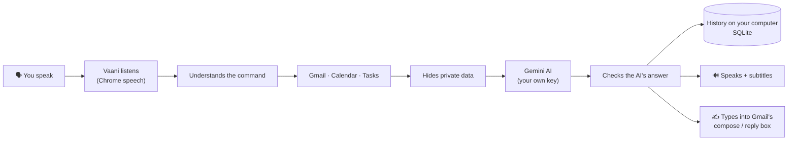

## Built with

| Part | Tools |
|---|---|
| Extension | TypeScript, Chrome Extension (Manifest V3), Shadow DOM, esbuild |
| Voice | Web Speech API (speech to text and text to speech) |
| AI | Google Gemini |
| Google | Gmail, Calendar and Tasks APIs, Google sign-in (OAuth 2.0) |
| Database | SQLite running inside the extension (sql.js / WebAssembly), with full-text search |
| Testing | Vitest (unit tests), Playwright (browser tests), GitHub Actions |
| Optional server | Node.js, Express, React dashboard |

## What I learned / technical highlights

- **Voice that feels natural:**
  - a wake word you pick yourself, matched by sound so small speech mistakes still work;
  - "stop" in about 150 ms, and you can talk over the assistant;
  - sentences spoken slowly or with pauses are joined before acting.
- **Ignoring its own voice:** speech that starts while the assistant talks is compared, in word order and allowing small changes ("summary" ≈ "sammary"), with everything it said in the last 20 seconds.
- **Working inside Gmail's page:** it finds Gmail's compose, reply and Send controls by stable attributes and types like a real user, so Gmail's own autosave and undo still work. It falls back to its own window if Gmail changes.
- **Making AI reliable:**
  - strict JSON answers;
  - every claim checked against the real email;
  - a fixed list of allowed actions;
  - automatic switching to another free model when one runs out.
- **Privacy first:** private data is hidden before the AI sees it, there's no backend, and the login token is kept only in session memory.
- **Security:**
  - sign-in safety checks;
  - it never accepts a Client Secret;
  - all email text is escaped before it's shown;
  - a **secret scanner** stops passwords and keys from being pushed to GitHub.
- **A real database in the browser:** SQLite compiled to WebAssembly, with search, reports, a job tracker and a "waiting for your reply" list.
- **Tests:**
  - 120+ unit tests;
  - browser tests that load the real extension with a fake microphone, a copy of Gmail's compose and reply boxes, and fake Google APIs;
  - checks for slow speech, echo and the send countdown.

## For developers

```bash
npm install
npm test            # run all tests
npm run typecheck   # check types
npm run release     # build → extension/release/vaani-extension
```

```
extension/   the Chrome extension (main product)
  src/gmail/   the overlay, voice, command understanding, writing in Gmail's boxes
  src/bg/      Google sign-in, Gmail, sync, AI, SQLite database
server/      shared AI logic + optional Node server
web/         optional React dashboard
design/      the "Wave" design file
docs/        screenshots, demo and guides
```

Never commit `.env` files, client secrets or API keys. A pre-commit hook scans every commit and blocks it if it finds one.

## Coming next

- Understanding attachments (PDF offer letters and so on)
- Chrome Web Store release

## Author

**Dinesh Saini**: a portfolio project about voice apps, reliable AI and privacy-first design.

## License

[MIT](LICENSE)
